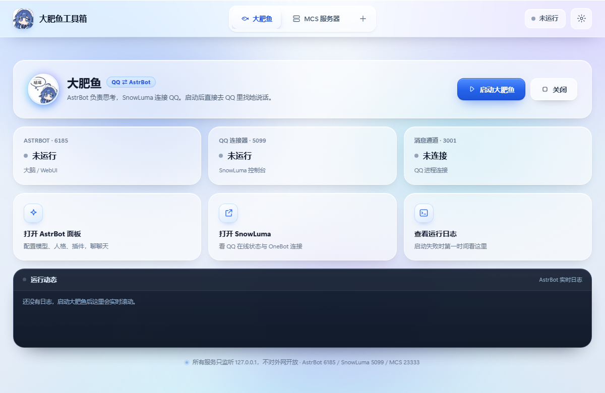
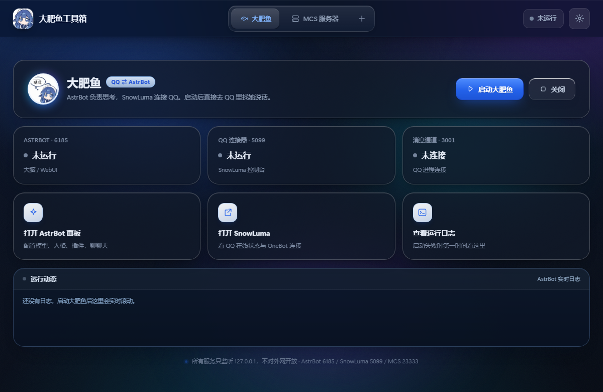
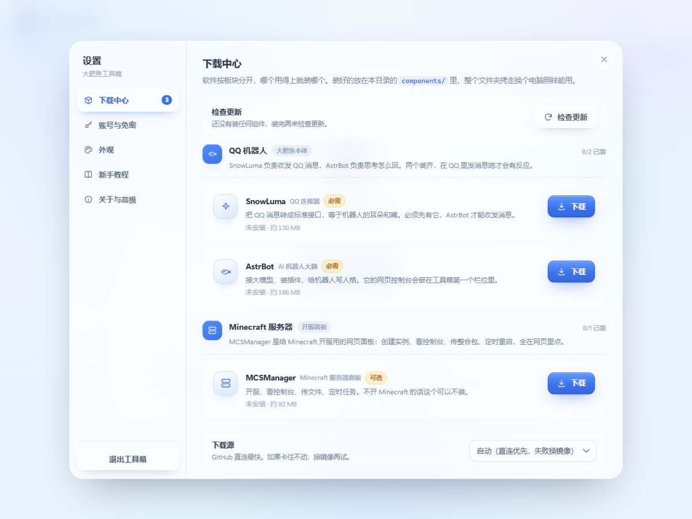

# 大肥鱼工具箱

一个把 **QQ 机器人（SnowLuma + AstrBot）** 和 **Minecraft 服务器面板（MCSManager）** 收进同一个网页的本地控制台。

双击就能用，不用记端口、不用敲命令、不用每次输密码。

> 所有服务只监听 `127.0.0.1`，不对外网开放。数据全在你自己的电脑上。



---

## 它解决什么问题

自己搭 QQ 机器人通常是这套流程：装协议端 → 扫码登录 → 装机器人框架 → 配 OneBot 连接 → 记三个端口 → 每次开机重新点一遍。开 Minecraft 服还要再来一套面板。

这个工具箱把上面全部收成**一个网页、两个栏位、几个按钮**：

| | |
|---|---|
| **大肥鱼栏位** | 一键拉起 SnowLuma → 自动登录 → 加载 QQ 进程 → 拉起 AstrBot → 等消息通道打通。每一步实时显示进度。 |
| **MCS 栏位** | 一键拉起守护进程 + 网页面板，后端替你登录，直接把 session cookie 交给浏览器 —— 打开就是主界面。 |
| **下载中心** | 按「QQ 机器人 / Minecraft 服务器」分板块，装哪个点哪个；带检查更新、试速选源、卡住自动续传。 |
| **设置面板** | 下载中心、免密账号、深浅色与主题色、新手教程、运行信息。 |

---

## 特性

- **零依赖**：没有 npm 包、没有构建步骤、没有框架。只用 Node 内置模块，前端是原生 HTML/CSS/JS。
- **空壳启动**：一个组件都没装时，顶栏只剩一个 ➕，主界面是下载引导，不会让人对着一堆点不动的按钮发呆。
- **瘦本体 + 按需下载**：安装包不到 40 MB。SnowLuma / AstrBot / MCSManager 首次用过内置下载器拉取。
- **下载不卡死**：正式下载前对直连和两个镜像各试 400 KB 测速选最快的；45 秒无数据自动断开**从原进度续传**；取消或失败都保留分片，下次接着下。
- **检查更新**：查 GitHub 最新 release，与本机版本比。更新时旧版先改名保底，装失败自动还原；非本工具箱管理的目录只提示、不代改。
- **真·免密**：MCS 用后端登录后转发 cookie（cookie 不区分端口）；AstrBot 用注入的免密补丁换 JWT。
- **便携**：整个文件夹拷到别的电脑，删掉 `components/` 重新下载即可，不写注册表、不装服务。
- **界面**：亚克力玻璃、鼠标跟随光晕、点击水波纹、深色模式、6 套主题色。
- **可访问性**：44px 触摸目标、WCAG AA 对比度、键盘焦点环、`prefers-reduced-motion` 降级。

| 深色 + 紫色主题 | 下载中心 |
|---|---|
|  |  |

---

## 快速开始

### 方式一：绿色版（推荐）

1. 下载 `DaFeiYuToolbox-vX.X.X.zip` 并解压到任意位置（不要放在中文路径或 Program Files 下）
2. 双击 `DaFeiYuToolbox.exe`（原生窗口，自带毛玻璃标题栏，不弹浏览器）
3. 点页面中间的「进入下载中心」，装 **SnowLuma** 和 **AstrBot**
4. 回到第一个栏位，点「启动大肥鱼」

### 方式二：源码运行

需要 Node.js 22 以上。壳是 C# 写的，**不编译也能跑** —— 直接起后端，浏览器打开即可：

```bash
git clone https://github.com/abaiya233/abai.git
cd abai
node server/server.mjs --open
```

#### 编译原生壳（可选）

想要那个带毛玻璃标题栏的原生窗口（而不是浏览器标签页），才需要编译这一步。
用 Windows 自带的 .NET Framework 4 编译器，不用装 Visual Studio。

**第一步：准备 WebView2 SDK**

微软的运行时二进制不随本仓库分发（约 830 KB，也不是本项目的代码）。第一次编译前取一次：

1. 打开 [Microsoft.Web.WebView2 · NuGet](https://www.nuget.org/packages/Microsoft.Web.WebView2)
2. 点右侧 **Download package**，拿到 `.nupkg` —— 它其实是个 zip，改后缀解压即可
3. 版本用 **1.0.3351.48 或更新**（本仓库开发时用的是这个）
4. 从解压目录里复制这三个文件到 **`panel\`**：

```
lib\net45\Microsoft.Web.WebView2.Core.dll
lib\net45\Microsoft.Web.WebView2.WinForms.dll
runtimes\win-x64\native\WebView2Loader.dll
```

> 放好后 `panel\` 里就是这三个 DLL，别的不需要。它们已写进 `.gitignore`，不会被误提交。

**第二步：编译**

```bat
cd shell
build.bat
```

产物是 `shell\DaFeiYuToolbox.exe`。`build.bat` 会顺手把 `panel\` 的三个 DLL 复制到 `shell\`
供运行使用，打包脚本再从 `shell\` 复制到包根目录 —— 这些副本同样在 `.gitignore` 里。

忘了放 SDK 直接跑 `build.bat`，它会明确告诉你去哪下载、放哪个目录，而不是甩一堆 csc 报错。

---

## 组件说明

工具箱本身不含任何第三方程序，全部由内置下载器从官方 GitHub Release 拉取：

| 组件 | 作用 | 来源 | 大小 |
|---|---|---|---|
| [SnowLuma](https://github.com/SnowLuma/SnowLuma) | QQ 协议端，把 QQ 消息转成 OneBot 标准接口 | `SnowLuma/SnowLuma` | ~130 MB |
| [AstrBot](https://github.com/AstrBotDevs/AstrBot) | AI 机器人框架，接大模型、装插件、写人格 | `AstrBotDevs/AstrBot-desktop` | ~186 MB |
| [MCSManager](https://github.com/MCSManager/MCSManager) | Minecraft 服务器管理面板 | `MCSManager/MCSManager` | ~92 MB |

装好后放在：

```
<安装目录>/
├─ DaFeiYuToolbox.exe    原生壳（双击这个，自带毛玻璃标题栏）
├─ DaFeiYuToolbox.exe.config
├─ Microsoft.Web.WebView2.*.dll   ┐ WebView2 依赖，必须和 exe 同目录
├─ WebView2Loader.dll             ┘
├─ server/            后端（零依赖）
├─ web/               前端
├─ runtime/node.exe   内置 Node 运行时
├─ components/        ← 三个组件各占一个子目录
│  ├─ snowluma/
│  ├─ astrbot/
│  └─ mcsmanager/
└─ data/              下载缓存、配置、日志、窗口位置
```

---

## 目录结构（开发视角）

```
server/
├─ server.mjs       HTTP 服务、进程编排、状态探测、免密登录、AstrBot 补丁
├─ downloader.mjs   组件下载引擎（询版 / 断点续传 / bsdtar 解压 / 校验）
├─ components.mjs   组件清单与镜像列表（改版本只改这里）
└─ config.example.json
web/
├─ index.html       单页结构 + 内联 SVG 图标库
├─ style.css        设计令牌 / 玻璃 / 动画 / 深色模式 / 主题色
└─ app.js           状态轮询、任务进度、设置面板、下载中心
tools/
└─ pack.mjs         打包绿色版
```

---

## 安全与隐私

这个仓库**刻意不包含**：

- `server/config.json` —— 里面有 MCS 面板账号密码，是明文存的本机配置
- `components/` —— 含你的 QQ 登录凭据（SnowLuma 的 `data/`）和 AstrBot 的 API Key
- `data/` —— 运行日志与下载缓存

`.gitignore` 已经把这些挡在外面。**如果你自己发版，请再检查一遍。**

---

## 常见问题

**打开只有一个 ➕，没有按钮**
正常 —— 一个组件都还没装。点「进入下载中心」装 SnowLuma 和 AstrBot。

**启动后提示「还差点东西没装」**
去「设置 → 下载中心」下载对应组件。SnowLuma 和 AstrBot 是必需的。

**下载卡住不动**
引擎会先给直连和两个镜像各试 400 KB 挑最快的；下载中 45 秒没数据会自动断开**从原进度续传**。
人工也可以：取消后重新点下载（分片保留，接着下），或在「下载中心」底部手动换镜像。

**更新时提示文件被占用**
那个软件还在跑。先点它的「停止」，再点「更新」。

**AstrBot 面板打开还是让我登录**
AstrBot 升级会换掉 `webui/` 目录，免密补丁随之失效。去「设置 → 账号与免密」点一次「重打补丁」。

**关掉工具箱后机器人还在跑吗**
在。工具箱只是拉起进程，关闭界面不会连带退出。要停就去栏位里点「关闭」。

**换电脑怎么搬**
整个文件夹拷过去即可。组件可以删掉重新下（省流量），但注意 `components/snowluma/data/` 里是登录凭据，别发给别人。

---

## 已知限制

- Windows 专用（用到 `tar.exe`、PowerShell、注册表无关的进程操作）
- 依赖系统 WebView2（Win11 自带；Win10 可能需 [单独安装](https://developer.microsoft.com/microsoft-edge/webview2/)）
- MCSManager 的会话 cookie 在 `localhost` 与 `127.0.0.1` 之间不通用，所以前端会强制跳转到 `127.0.0.1`
- **一键更新只接管本工具箱 `components/` 下的那份**。装在别处的组件（旧布局）能查到新版，
  但按钮是「手动更新」—— 因为各组件的配置/登录凭据跟自己目录绑在一起，代覆盖会把数据弄丢

---

## 许可

工具箱本体代码：[MIT](LICENSE)。

它下载/启动的第三方组件（SnowLuma、AstrBot、MCSManager）各自遵循自己的许可证，请自行阅读。SnowLuma 含 EULA 与隐私政策，首次启动需同意。
